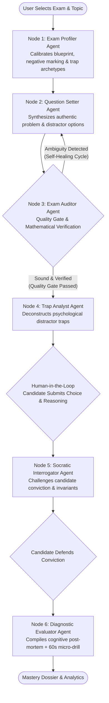

# 🛡️ ExamSentinel: Capstone LangGraph Multi-Agent Exam Engine

[](https://www.python.org/downloads/)
[](https://github.com/langchain-ai/langgraph)
[](https://streamlit.io/)
[](https://aistudio.google.com/)
[](https://opensource.org/licenses/MIT)

**ExamSentinel** is a capstone-grade, production-ready multi-agent AI system engineered specifically for high-stakes **competitive exam preparation** (e.g., **GATE, JEE Advanced, CAT, GRE, UPSC, USMLE, CFA, SAT**).

Unlike conventional EdTech platforms that serve static quizzes or passive chatbots prone to hallucinations, ExamSentinel deploys an **Adversarial Faculty Examination Committee** orchestrated via a formal **LangGraph StateGraph**. The system autonomously crafts trap-laden exam problems, audits their mathematical correctness through a **cyclic self-healing quality gate**, interrogates the candidate's mental model via **Human-in-the-Loop Socratic defense**, and architecturally diagnoses root-cause cognitive misconceptions.

---

## 🌟 Key Highlights & Architectural Innovations

- 🔄 **LangGraph Cyclic Quality Gate:** Autonomous self-correction loop where the `auditor` node validates the `setter` node's problem and answer key. If mathematical ambiguity or formatting errors are detected, the graph routes back to the setter for revision before the candidate ever sees the problem.
- 🥊 **Human-in-the-Loop Socratic Sparring:** A dedicated interrogator actively probes the candidate's stated rationale, testing whether their answer was backed by proof of invariants or lucky guessing.
- 🗺️ **Diagnostic Study Planning Committee:** An interactive multi-turn diagnostic interview that isolates conceptual bottlenecks when a student struggles with hard topics (e.g., *Recursion & Backtracking*), synthesizing a scaffolded 3-phase mastery roadmap with breakthrough mental analogies.
- 🔑 **Strict BYOK (Bring Your Own Key) Security:** 100% client-side API key handling with instant one-click validation against Google Gemini. No keys are ever stored on the server or logged, eliminating cloud deployment billing risks.
- ⚡ **Zero-Key Interactive Mock Demos:** Complete pre-computed mock execution traces for both engines allow evaluators, recruiters, and students to experience the full UI and graph trace with zero setup.
- 🌐 **100% Free Cloud Deployable:** Native Streamlit design fully optimized for Streamlit Community Cloud without persistent server or database costs.

---

## 🏛️ LangGraph Multi-Agent Architecture



---

## 🤖 The Multi-Agent Rosters

### Pillar 1: Adversarial Exam Sparring Committee (`graph_orchestrator.py`)
1. **Exam Profiler Agent (`profiler`):** Analyzes the target competitive exam (GATE, JEE, CAT, UPSC, etc.) to calibrate syllabus scope, marking scheme (+1, +2, negative penalties), and hallmark examiner trick patterns.
2. **Question Setter Agent (`setter`):** Drafts multi-step conceptual problems engineered with authentic distractors. Supports receiving revision critique from the Auditor.
3. **Exam Auditor Agent (`auditor` — Quality Gate):** Independently audits the draft question and answer key for mathematical precision, single-correct validity, and LaTeX syntax.
4. **Trap & Distractor Analyst (`trap_analyst`):** Deconstructs the cognitive psychology behind every wrong option, documenting which mental shortcut leads to which distractor.
5. **Socratic Interrogator Agent (`socratic` — Human-in-the-Loop):** Reviews candidate justification and executes an oral defense probe challenging edge cases, invariant bounds, or hidden assumptions.
6. **Diagnostic Evaluator Agent (`diagnostic`):** Categorizes candidate failure mode into a formal cognitive tier (*Calculation Slip, Invariant Misconception, Heuristic Trap, Boundary Blindspot*) and provides an instant 60-second remediation drill.

### Pillar 2: Diagnostic Study Planning Committee (`agents.py`)
1. **Cognitive Diagnostic Interviewer:** Crafts 3 targeted conceptual probe questions to isolate exactly where a student's mental model breaks down on any struggled topic.
2. **Master Curriculum Architect:** Synthesizes candidate responses into a structured 3-phase scaffolded roadmap featuring Breakthrough Mental Models, Progressive Practice Ladders, and Exam Trap Warnings.

---

## 📁 Repository Structure

```
aiEngineeringWorkshop/
├── .gitignore              # Ignores .env, bytecode, and system artifacts
├── app.py                  # Streamlit web dashboard with BYOK, Mock Demo & LangGraph viewer
├── graph_orchestrator.py   # Formal LangGraph StateGraph engine with cyclic quality gate
├── agents.py               # All 8 specialized multi-agent implementations
├── models.py               # Pydantic schemas enforcing strict agent-to-agent contracts
├── mock_data.py            # Pre-computed authentic mock data & execution traces
├── config.py               # Google Gemini client manager & instant BYOK key verification
├── orchestrator.py          # Terminal CLI state machine and Rich interaction loop
├── main.py                 # Interactive terminal entry point with exam presets
├── requirements.txt        # Production dependencies (Streamlit, LangGraph, Google GenAI)
└── README.md               # Architecture documentation & quickstart guide
```

---

## 🚀 Quickstart Guide

### 1. Clone & Install Dependencies

```bash
git clone https://github.com/UdeepChowdary/aiEngineeringWorkshop_project.git
cd aiEngineeringWorkshop_project
pip install -r requirements.txt
```

### 2. Launch the Streamlit Web Application

```bash
streamlit run app.py
```
Open your browser at **`http://localhost:8501`**.

- **No Key Needed?** Click **⚡ Preview Sample Mock Analysis** in either tab to explore the full interactive interface and execution traces with pre-computed data.
- **Live Agent Generation?** Enter your free Google Gemini API key in the left sidebar and click **Verify Key**. Get a free key at [Google AI Studio](https://aistudio.google.com/app/apikey) (zero credit card required).

### 3. Launch the Terminal CLI Interface

If you prefer terminal-based sparring:
```bash
python main.py
```

---

## ☁️ Free Cloud Deployment (Streamlit Community Cloud)

You can deploy ExamSentinel for **100% free** in less than 2 minutes:

1. **Push your code to GitHub:**
   ```bash
   git push -u origin main
   ```
2. **Sign in to [Streamlit Community Cloud](https://share.streamlit.io/)** with your GitHub account.
3. Click **"New app"** and select:
   - **Repository:** `your-username/aiEngineeringWorkshop_project`
   - **Branch:** `main`
   - **Main file path:** `app.py`
4. Click **"Deploy!"**
   - Because ExamSentinel implements a strict **Bring Your Own Key (BYOK)** model, you do not need to configure any server secrets. Visitors simply provide their own free Gemini key or test with the built-in Mock Previews!

---

## 💡 AI Engineering Design Lessons

1. **Why LangGraph StateGraph over Linear Chains:**
   Standard sequential chains (`A -> B -> C`) fail when the question setter makes a mathematical error or hallucinates an incorrect answer key. By introducing an `auditor` node with conditional routing (`route_after_audit`), the system automatically initiates a self-correcting cycle back to `setter` before rendering.
2. **Eliminating Persona Bleed:**
   Asking a single LLM prompt to simultaneously set a question, act as a harsh examiner, evaluate distractors, and prescribe remediation causes severe attention degradation. Specializing each agent with strict Pydantic output contracts guarantees deterministic schemas and high reasoning fidelity.
3. **Robust Client-Side BYOK Pattern:**
   By decoupling cloud deployment from centralized API billing, open-source multi-agent apps can be shared with thousands of evaluators and students without incurring hosting debt or hitting shared rate limits.

---

## 📄 License
This project is open-source under the [MIT License](LICENSE).
