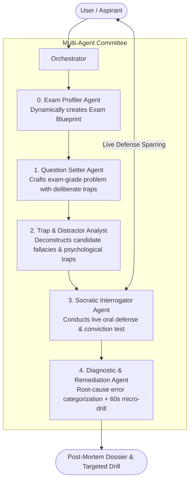

# 🛡️ ExamSentinel: Universal Multi-Agent Competitive Exam Sparring Engine

An adversarial, multi-agent AI system designed specifically for **competitive exam preparation** (e.g., GATE, JEE, CAT, GRE, GMAT, UPSC, USMLE, CFA, SAT).

Unlike standard "EdTech" apps that serve passive videos or trivial quizzes, **ExamSentinel** simulates a full **Examiner Committee** that crafts high-difficulty problems with deliberate traps, interrogates your thought process in a live Socratic oral defense, deconstructs the psychology of every distractor option, and diagnoses your exact cognitive failure modes.

---

## 🏛️ System Architecture



---

## 🤖 The Multi-Agent Systems

### System 1: The Adversarial Sparring Committee
1. **Exam Profiler Agent**: Dynamic blueprint & scoring calibration for any exam.
2. **Question Setter Agent**: High-caliber problem synthesis with authentic boundary conditions.
3. **Trap & Distractor Analyst**: Deconstructs student psychology & cognitive traps.
4. **Socratic Interrogator**: Conducts active terminal & web oral defense.
5. **Diagnostic Evaluator**: Post-mortem error taxonomy + 60-second micro-drill.

### System 2: The Diagnostic Study Planning Committee
1. **Cognitive Diagnostic Interviewer Agent**: Formulates 3 targeted diagnostic probe questions to isolate where a student's mental model is failing when they struggle with a topic (e.g. *Recursion*).
2. **Master Curriculum & Study Architect Agent**: Synthesizes the student's interview responses into a personalized, day-by-day mastery roadmap with breakthrough mental analogies, progressive phases, practice ladders, and exam benchmarks.

---

## 🚀 Quickstart Guide

### 1. Requirements
Ensure you have the required packages installed:
```bash
pip install groq rich pydantic python-dotenv
```

### 2. Environment Setup
Your Groq API key can be set in an `.env` file or exported as an environment variable:
```bash
# Optional if set in config.py
export GROQ_API_KEY="your-groq-api-key"
```

### 3. Launch the Sparring Engine
Run the main interactive entry point:
```bash
python main.py
```

You can choose from popular exam presets or type **`C`** to test **ANY exam and topic** on the planet!

---

## 📁 Project Structure

```
aiEngineeringWorkshop/
├── config.py           # Groq client initialization, model defaults, API key handling
├── models.py           # Pydantic data schemas enforcing strict agent-to-agent contracts
├── agents.py           # Implementations of the 5 specialized AI agents
├── orchestrator.py     # State machine and rich terminal UI interaction loop
├── main.py             # CLI entrypoint with presets, custom exam mode, and session tracking
├── script.py           # Original single-agent baseline script
└── README.md           # Architecture documentation & workshop guide
```

---

## 💡 AI Engineering Workshop Talking Points

1. **Why Multi-Agent beats Single-Prompt LLMs:**
   * A single prompt asked to *"Make an exam question, quiz the user, be Socratic, and analyze mistakes"* degrades in quality due to attention fragmentation.
   * By separating concerns into **Question Setter $\rightarrow$ Trap Analyst $\rightarrow$ Socratic Interrogator $\rightarrow$ Diagnostic Evaluator**, each agent operates with a focused system prompt and zero persona bleed.
2. **Deterministic Schemas via Pydantic:**
   * Agents pass typed, validated JSON structures (`ExamBlueprint`, `DistractorMap`, `DiagnosticReport`), preventing hallucinations from breaking the execution pipeline.
3. **High-Speed Official Google GenAI SDK:**
   * Running on official Google Gemini models (`gemini-3.5-flash`) ensures robust reasoning, native JSON schema support, and rapid turnaround for conversational sparring.
